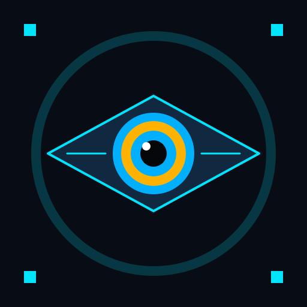
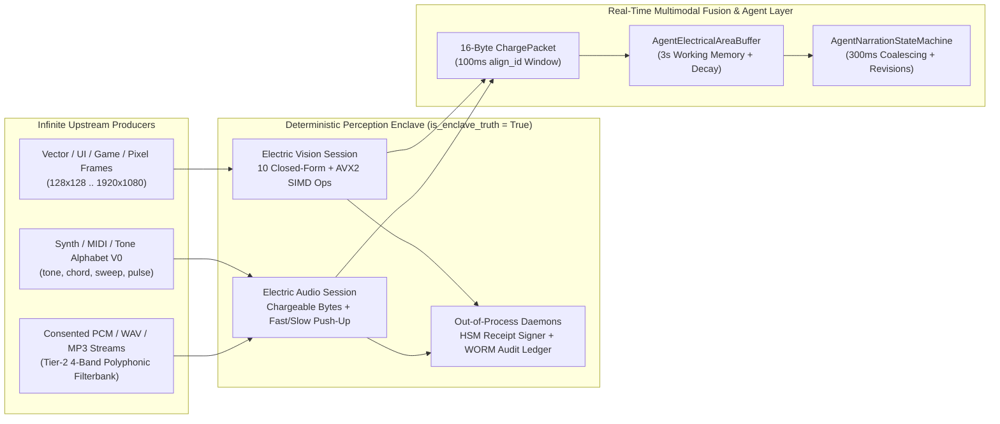

# Electric Sight & Sound for Agents

**Deterministic Pixel & Chargeable-Byte Audio Perception Enclave for Autonomous AI Agents**



[](LICENSE)
[](pyproject.toml)
[-success.svg)](Makefile)

**Electric Sight & Sound** is a baseline, zero-dependency, open-source perception engine that gives AI agents **deterministic eyes and ears** — built as a physical sensor enclave rather than a black-box neural vibe.

It is designed to be **connected to an infinite number of upstream producers and downstream agent workflows** (LLMs/VLMs, game engines, DAWs, robotics simulators, UI renderers, accessibility tools, neuromorphic event buses, and media pipelines) via a compact **16-byte wire protocol (`ChargePacket`)** and cryptographically countersigned **Observation Receipts**.

---

## Why Electric Sight & Sound?

1. **Chargeable-Byte Audio ("Bytes Get Charged Up During Play")**:
   - Audio is translated into a 2D time-frequency matrix of **chargeable bytes (`0..255`)**.
   - Before playback (`playhead_slot == -1`), all chargeable bytes rest at `0`.
   - As the playhead sweeps across the sound, bytes at the active time slot are **pushed up (charged up)** across two multi-scale temporal lanes:
     - **Fast Charge Lane (`q_fast`, ~50 ms half-life)**: Captures sharp transients, consonant/phoneme onsets, drum hits, and rapid pitch shifts.
     - **Slow Charge Lane (`q_slow`, ~1.5 s half-life)**: Acts as a built-in short-term capacitor retaining harmonic contour, sustained chords, and mood without requiring extra RNN state.
   - **Refractory & Saturation Guards**: Per-band `0..255` ceiling and refractory cooldown ticks prevent loud bursts or adversarial clipping from flooding agent attention.
2. **Deterministic Electric Vision (`128x128` to `1920x1080`)**:
   - 10 closed-form integer/`Q16.16` spatial operators + native C11/AVX2 (`prod_gate_native_simd.c`) & Rust (`#![forbid(unsafe_code)]`, `prod_gate_native_simd.rs`) SIMD operators (`10,000/10,000` differential fuzz parity, `0` divergences).
   - Continuous streaming ring-buffer (`ContinuousElectricEyeStream`) with `explicit_bzero` zeroization on frame eviction, $16\times16$ dirty-tile bitmasks, and automatic `verified -> stale` epistemic decay watchdogs.
3. **Three-Clock Multimodal Fusion & Working-Memory "Electrical Area"**:
   - Packs visual (`modality=0`), audio (`modality=1`), and fused (`modality=2`) events into a **16-byte binary `ChargePacket`**.
   - Time-aligns visual and auditory push-ups within `100 ms` `align_id` windows inside a sliding 3-second [`AgentElectricalAreaBuffer`](electric_audio_agent_bridge.py) with deduplication, half-life decay eviction, and `revision=1` tokens.
4. **Strict Epistemic Hygiene (`SEMANTIC_BOUNDARY_CONTRACT`)**:
   - **Enclave Sensor Layer (`is_enclave_truth=True`, `claims_semantic_meaning=False`)**: Emits deterministic pixel/charge measurements, explainable push-up traces, and HMAC-SHA256 countersigned receipts (`ObservationReceipt`).
   - **Agent Interpreter Layer (`is_enclave_truth=False`)**: External LLM/ASR/mood interpretations and coalesced narrations ([`AgentNarrationStateMachine`](electric_audio_agent_bridge.py)) are wrapped in [`create_agent_interpretation_envelope()`](electric_audio_agent_bridge.py) so stochastic hypotheses are never confused with sensor truth.

---

## Architecture Diagram



---

## Quick Start (Zero External Python Dependencies)

Requires **Python 3.10+** on Linux (and `gcc` if rebuilding `libprod_gate_simd.so`).

```bash
# 1. Build the native C11/AVX2 SIMD library, run all 31 unit test suites, and run CLI self-tests
make all

# 2. Run the universal connector demonstration
make demo

# 3. Run the Electric Audio & Sight+Sound CLI self-test
python3 electric_audio_cli.py --no-color --plain --mode focus selftest

# 4. Run the Electric Vision CLI self-test
python3 electric_vision_cli.py --no-color --plain --mode focus selftest

# 5. Inspect an explainable causal push-up trace on Tone Alphabet audio
python3 electric_audio_cli.py --no-color --plain charge-trace --tone-text "HELLO WORLD" --top-k 5
```

---

## Connecting Anything to Electric Sight & Sound

Because the enclave exposes clean Python session managers, a 16-byte binary packet codec, and JSON/ASCII CLI tools, you can wire it into any system:

### 1. Connect Any PCM / WAV / Decoded Audio Stream (Tier-2 4-Band Polyphonic Filterbank)

```python
from electric_audio_agent_bridge import (
    ElectricAudioAgentSession,
    validate_and_translate_consented_pcm_samples,
    explain_charge_push_up_trace,
)

# Feed 16-bit mono PCM samples (8kHz..48kHz) with an explicit consent token
tier2 = validate_and_translate_consented_pcm_samples(
    pcm_samples_i16,
    sample_rate_hz=16000,
    origin_attestation="owner_supplied_audio",
    consent_token={"consented": True, "token_id": "tok_session_01"},
    time_slots=256,
    freq_bands=64,
)

# Inspect 4-band polyphonic split (Sub-Bass 55-280Hz, Low-Mid 280-900Hz,
# Vocal Formant 900-3400Hz, High Brilliance 3.4-7kHz) and section-drop detection
print(tier2["four_band_polyphonic_profile"])
print(tier2["dynamic_and_tempo_profile"])

with ElectricAudioAgentSession(default_grid=(256, 64)) as session:
    session.register_chargeable_audio(
        "src_custom_track", "v1", tier2["translated_events"],
        playhead_ratio=1.0, origin_attestation="owner_supplied_audio",
    )
    report = session.inspect_audio("src_custom_track", "v1", issue_observation_receipt=True)
```

### 2. Connect Multimodal Vision + Audio in Real Time (`16-Byte ChargePacket`)

```python
from electric_audio_agent_bridge import (
    MODALITY_VISION,
    MODALITY_AUDIO,
    AgentElectricalAreaBuffer,
    AgentNarrationStateMachine,
    pack_charge_packet_16bytes,
)

area = AgentElectricalAreaBuffer(window_ms=3000)
narrator = AgentNarrationStateMachine(coalesce_window_ms=300)

# Vision event at t=110ms + Audio transient at t=145ms -> fused into align_id=1!
area.ingest_sensory_packet(t_ms=110, modality=MODALITY_VISION, f_band=32, q_fast=145, q_slow=70)
res = area.ingest_sensory_packet(t_ms=145, modality=MODALITY_AUDIO, f_band=48, q_fast=180, q_slow=95)

wire_bytes = pack_charge_packet_16bytes(res["fused_packet"])  # 16 bytes ready for IPC/UDP/WebSocket
narrator.push_packet(res["fused_packet"])
utterance = narrator.flush(current_t_ms=450)
```

---

## Empirical Multi-Genre Benchmark (10 Real-World Tracks)

Tested across 10 real-world tracks spanning a cappella, hip-hop, nu-metal, acoustic folk, liquid drum & bass, synth-pop, gabber, 1960s soul, crunk, and pop on a `256×64` chargeable-byte grid:

| Genre / Archetype | Sub-Bass (`55–280Hz`) | Low-Mid (`280–900Hz`) | Vocal Formant (`900–3400Hz`) | Brilliance (`3.4–7kHz`) | Polyphonic Chords | Section Drop (`Δu8`) | Charge Regime | Centroid |
| :--- | :---: | :---: | :---: | :---: | :---: | :---: | :---: | :---: |
| **A Cappella & Whistling** | 20.5% | 48.7% | 23.0% | 7.8% | **0** *(monophonic)* | `False` (`8`) | `fast_transient_dominant` | `647 Hz` |
| **West Coast Hip-Hop (808s)** | **32.4%** | 39.8% | 19.4% | 8.3% | **156** | `False` (`14`) | `balanced_attack_sustain` | **`257 Hz`** |
| **Nu-Metal (Distorted Guitars)** | **33.4%** | 36.0% | 18.7% | 11.9% | **251** *(wall of sound)* | `False` (`17`) | `slow_sustained_memory` | `554 Hz` |
| **Intimate Acoustic Folk** | 35.5% | 44.9% | 14.0% | 5.6% | **1** *(sparse guitar)* | `False` (`7`) | `fast_transient_dominant` | `323 Hz` |
| **Liquid Drum & Bass (174 BPM)** | 29.5% | 38.4% | 20.1% | 12.0% | **184** | **`True` (`+100`!)** | `slow_sustained_memory` | `698 Hz` |
| **80s Synth-Pop** | 21.5% | 36.6% | 26.1% | **15.8%** | **28** | `False` (`9`) | `fast_transient_dominant` | `513 Hz` |
| **90s Gabber / Rave (~190 BPM)** | 26.1% | 42.6% | 20.2% | 11.1% | **231** | **`True` (`+51`)** | `slow_sustained_memory` | `440 Hz` |
| **1960s Soul & Horn Section** | **14.1%** *(vintage)* | 43.6% | **28.8%** *(highest)* | 13.5% | **85** | **`True` (`+27`)** | `balanced_attack_sustain` | **`1630 Hz`** |
| **2000s Crunk (Synth Lead + 808)** | 29.8% | 29.4% | 24.0% | **16.8%** *(highest)* | **235** | `False` (`9`) | `slow_sustained_memory` | `754 Hz` |
| **Modern Pop** | 32.7% | 37.8% | 18.6% | 10.9% | **238** | **`True` (`+27`)** | `slow_sustained_memory` | `475 Hz` |

---

## Repository Structure

| File | Description |
| :--- | :--- |
| [`electric_eye_harness.py`](electric_eye_harness.py) | Core 5-layer epistemic harness, `E1`–`E10` scenarios, and `C1`–`C9` pass criteria. |
| [`exec_gate_daemons.py`](exec_gate_daemons.py) | Out-of-process `AF_UNIX` Vault, Audit WORM Sink, and Quarantine/Kill-Switch daemons (`EXEC-GATE-1..3`). |
| [`prod_gate_enclave.py`](prod_gate_enclave.py) | Out-of-process HSM/KMS enclave, `NativeSimdOperatorEngine`, PII canary scrubber, and WCAG validator (`PROD-GATE-1..4`). |
| [`prod_gate_native_simd.c`](prod_gate_native_simd.c) / [`prod_gate_native_simd.rs`](prod_gate_native_simd.rs) | Native C11/AVX2 + Rust (`#![forbid(unsafe_code)]`) SIMD operator library. |
| [`electric_vision_agent_bridge.py`](electric_vision_agent_bridge.py) | Multi-resolution (`128x128`..`1920x1080`) agent vision bridge & [`ContinuousElectricEyeStream`](electric_vision_agent_bridge.py). |
| [`electric_vision_cli.py`](electric_vision_cli.py) | Standalone Electric Vision CLI (`cyclops-ee-ctl`). |
| [`electric_audio_agent_bridge.py`](electric_audio_agent_bridge.py) | Chargeable-Byte Electric Audio bridge, [`ContinuousElectricEarStream`](electric_audio_agent_bridge.py), [`ElectricSightAndSoundSession`](electric_audio_agent_bridge.py), 16-byte `ChargePacket`, [`AgentElectricalAreaBuffer`](electric_audio_agent_bridge.py), and Tier-2 4-band PCM validator. |
| [`electric_audio_cli.py`](electric_audio_cli.py) | Standalone Electric Audio & Sight+Sound CLI (`cyclops-ea-ctl`). |
| [`examples/connect_anything_demo.py`](examples/connect_anything_demo.py) | Universal connector script demonstrating Sight+Sound, Tier-2 PCM, and 16-byte `ChargePacket` fusion. |
| [`test_electric_eye_harness.py`](test_electric_eye_harness.py) / [`test_electric_audio_harness.py`](test_electric_audio_harness.py) | Complete 31-suite unit & integration verification harness. |

---

## License

Released under the [MIT License](LICENSE).
